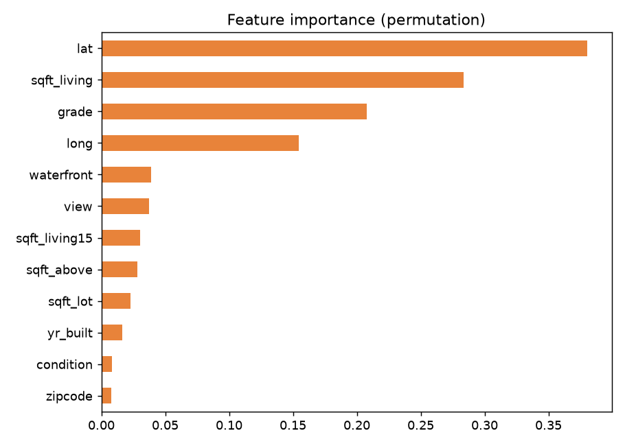
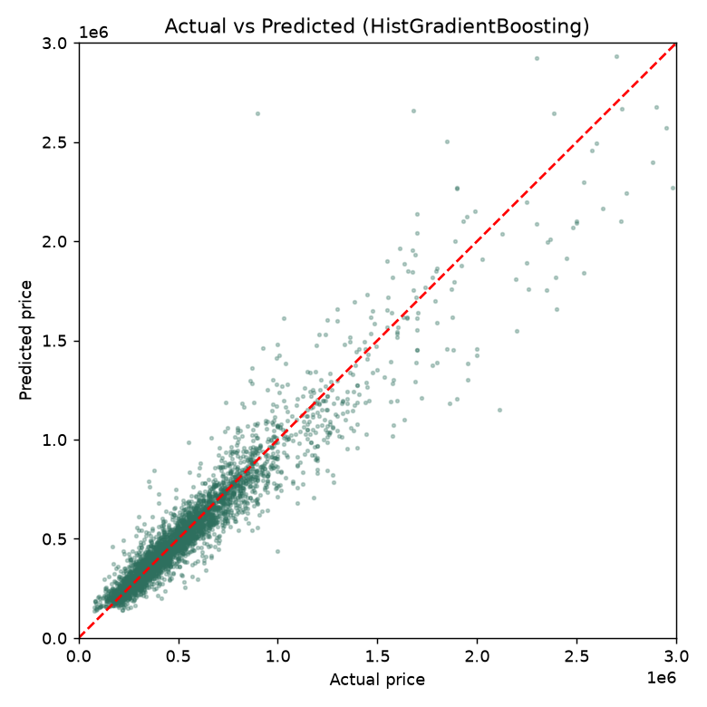

# 🏠 Seattle House Price Prediction (Advanced)

End-to-end ML project that predicts house prices in King County (Seattle, USA)
and also gives a **likely price range**, not just a single number.

🔗 **Live demo:** <https://house-price-advanced.streamlit.app/>

## Highlights
- Leakage-free evaluation: `GroupShuffleSplit` so the same house never appears in both train and test
- Feature engineering: distance to downtown, house age, renovation flag, total sqft, etc.
- sklearn `Pipeline` with log-transformed target in a single object
- Compared multiple models using R², MAE, RMSE and GroupKFold cross-validation
- 80% prediction interval using quantile models
- Feature importance and an interactive Streamlit app

## Results
| Model | R² | MAE | RMSE |
| HistGrandientBoosting | 0.913 | 62372 | 109568
| XGBoost | 0.912 | 61556 | 110445
| LightGBM | 0.91 | 61917 | 111683
| Random Forest | 0.875 | 70687 | 131457
| Linear Regression | 0.812 | 97699 | 161556
Cross-validation R² (mean): <cv_r2_mean>
Prediction interval coverage: <interval_coverage x 100>% (target 80%)




## Project structure
- `features.py`: data loading and feature engineering
- `eda.py`: exploratory plots
- `train.py`: model comparison, cross-validation, intervals, saving
- `app.py`: Streamlit web app
- `data/`: put `kc_house_data.csv` here
- `images/`: generated plots

## How to run
```bash
pip install -r requirements.txt
python eda.py
python train.py
streamlit run app.py
```

## Dataset
Kaggle: "House Sales in King County, USA". Download `kc_house_data.csv`
and place it in the `data/` folder.

## Limitations
- Data is from 2014-15 and covers only the Seattle area (prices in USD)
- In the app, neighbourhood features (sqft_living15, sqft_lot15) are set equal to the house's own values
- Interval coverage is below the 80% target, so the model is slightly overconfident

## Tech stack
Python, pandas, NumPy, scikit-learn, matplotlib, Streamlit
